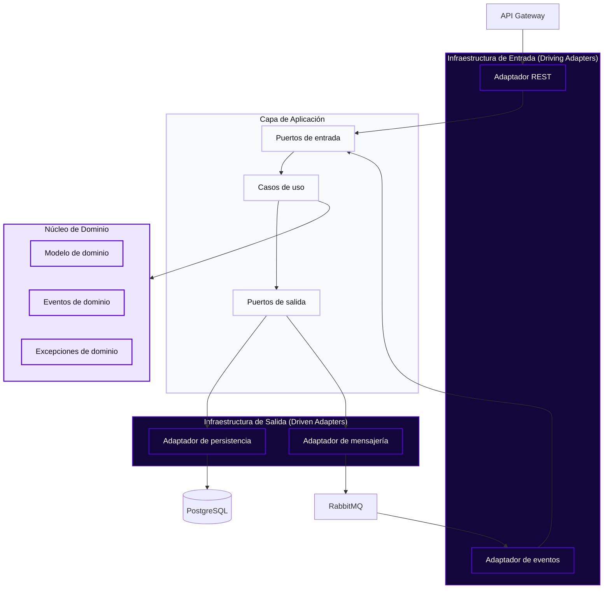
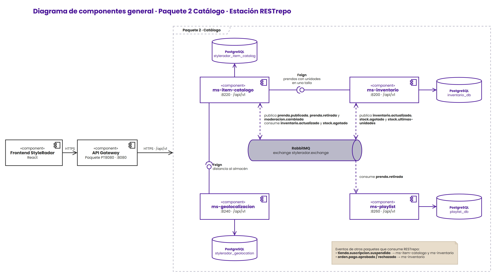
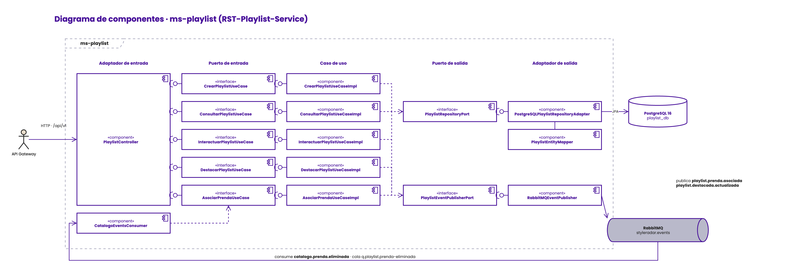
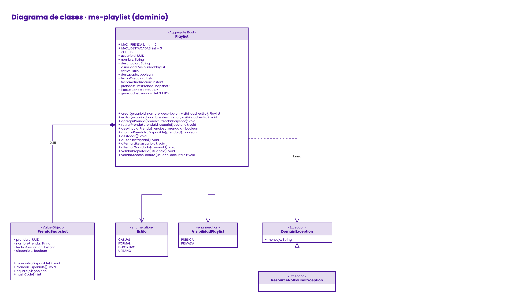
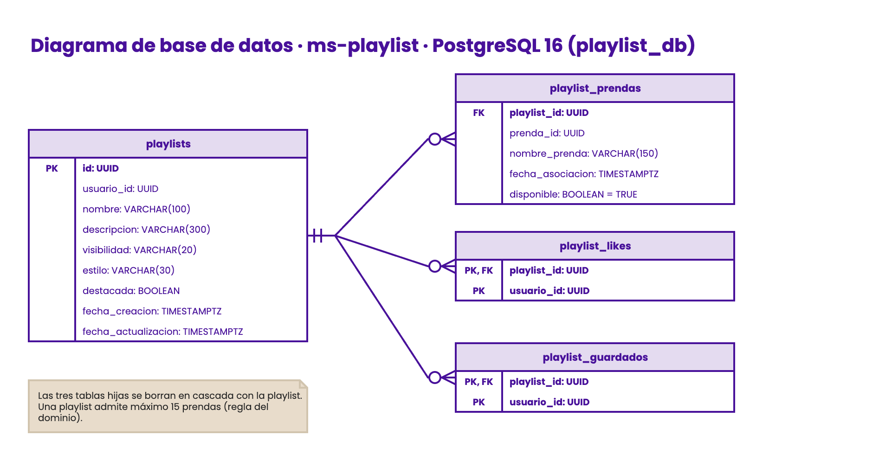
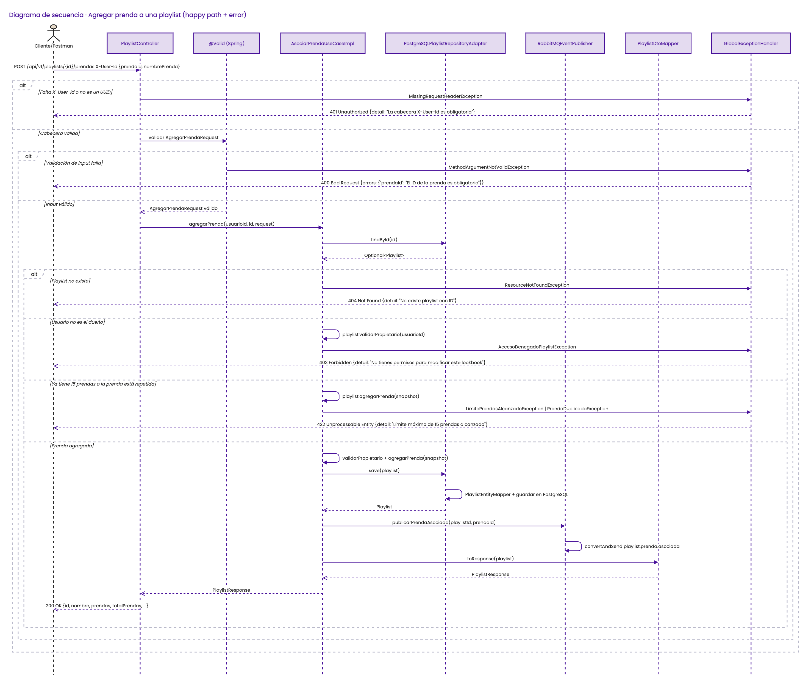
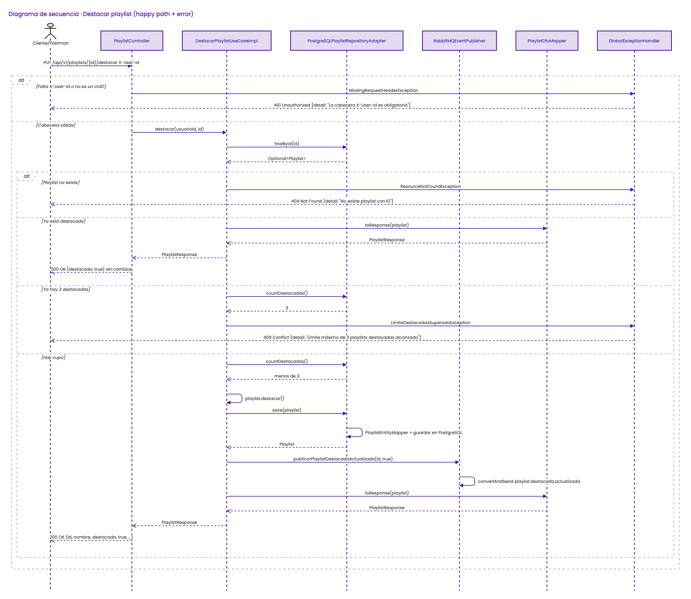
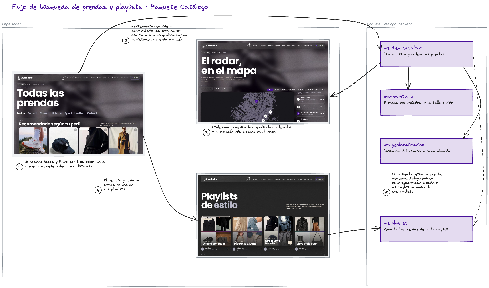
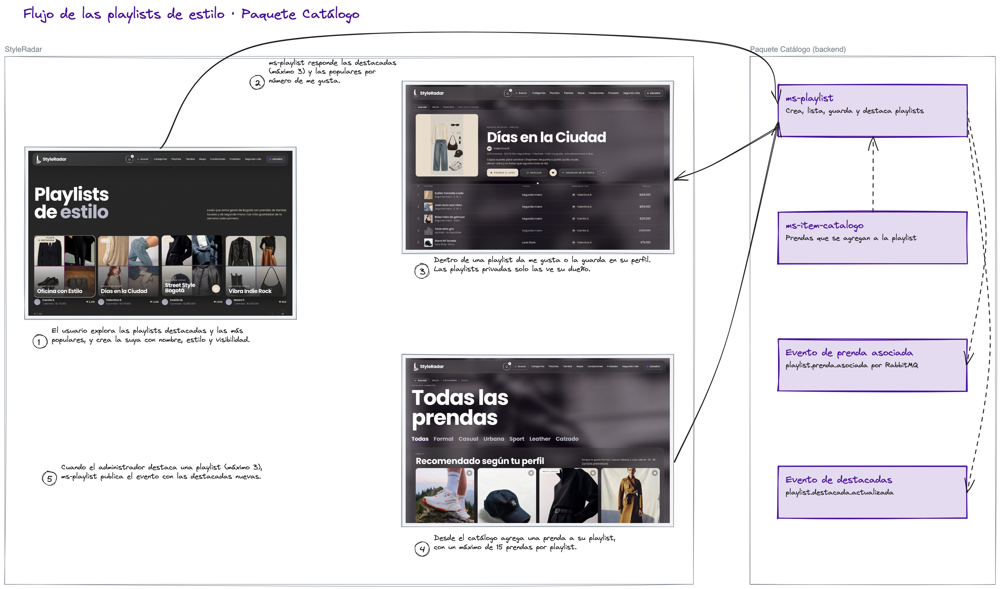
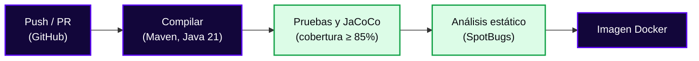

<div align="center">

  <a href="https://github.com/StyleRadar1">
    
  </a>

  <h1>STYLE<font color="#5600EF">RADAR</font> &nbsp;·&nbsp; <code>ms-playlist</code></h1>

  <p align="center">
    
    
    
  </p>

  <p align="center">
    <strong><font color="#5600EF">Descubre tu estilo. En tu ciudad.</font></strong><br />
    <em>Plataforma de moda local con inventario multi-sede geolocalizado en tiempo real y probador virtual para Bogotá.</em>
  </p>

  <p align="center">
    <a href="https://github.com/StyleRadar1/RST-Playlist-Service/actions/workflows/ci.yml">
      
    </a>
    <a href="#9-pruebas-y-cobertura">
      
    </a>
    <a href="#6-tecnologías-y-dependencias">
      
    </a>
    <a href="#6-tecnologías-y-dependencias">
      
    </a>
    <a href="#7-cómo-ejecutar-local-y-con-docker">
      
    </a>
  </p>

</div>


---

##  ÍNDICE DE CONTENIDOS

1. [Nombre del servicio y su bounded context](#1-nombre-del-servicio-y-su-bounded-context)
2. [Equipo y responsables](#2-equipo-y-responsables)
3. [Arquitectura hexagonal con su diagrama](#3-arquitectura-hexagonal-con-su-diagrama)
4. [Endpoints y enlace a Swagger](#4-endpoints-y-enlace-a-swagger)
5. [Eventos que publica y consume](#5-eventos-que-publica-y-consume)
6. [Tecnologías y dependencias](#6-tecnologías-y-dependencias)
7. [Cómo ejecutar local y con Docker](#7-cómo-ejecutar-local-y-con-docker)
8. [Variables de entorno](#8-variables-de-entorno)
9. [Pruebas y cobertura](#9-pruebas-y-cobertura)
10. [CI/CD con el badge del pipeline](#10-cicd-con-el-badge-del-pipeline)
11. [Ramas y cómo contribuir](#11-ramas-y-cómo-contribuir)
12. [Enlace a la épica en Jira](#12-enlace-a-la-épica-en-jira)

---

<a id="1-nombre-del-servicio-y-su-bounded-context"></a>

##  1. NOMBRE DEL SERVICIO Y SU BOUNDED CONTEXT

* **Identificador de Servicio:** `ms-playlist`
* **Paquete Arquitectónico:** `Paquete 2: Catálogo`
* **Puerto de Escucha Oficial:** `8260`
* **Base de Datos Asignada:** `PostgreSQL 16` (`playlist_db`), aislada bajo el patrón *Database-per-Service*.
* **Bounded Context:** `Playlists de estilo`

### Responsabilidades del Dominio

Este microservicio encapsula exclusivamente la lógica de negocio de las playlists de estilo creadas por los usuarios compradores de StyleRadar.

| Qué HACE este Microservicio (Alcance) | Qué NO HACE este Microservicio (Límites) |
| :--- | :--- |
| • Crea y configura playlists públicas o privadas. | • NO autentica usuarios. |
| • Agrega y retira prendas de una playlist. | • NO publica ni edita prendas (delegado a `ms-item-catalogo` en `:8220`). |
| • Registra los Me gusta y las playlists guardadas. | • NO gestiona el inventario por talla (delegado a `ms-inventario` en `:8200`). |
| • Destaca las playlists con mayor interacción. | • NO accede directamente a bases de datos de otros microservicios. |

### Arquetipos de Moda y Personajes de StyleRadar

<div align="center">

| Antonia (Sastre) | Mateo (Calle) | Aura (Futuro) | Nora (Rebelde) | Tomás (Esencial) |
| :---: | :---: | :---: | :---: | :---: |
| <br>**Sastre**<br><sub>Tiendas & Descubrimiento</sub> | <br>**Calle**<br><sub>Playlists & Cultura Urbana</sub> | <br>**Futuro**<br><sub>Probador Virtual AI</sub> | <br>**Rebelde**<br><sub>Segunda Vida & Vintage</sub> | <br>**Esencial**<br><sub>Fundaciones & Donaciones</sub> |

</div>

---

<a id="2-equipo-y-responsables"></a>

##  2. EQUIPO Y RESPONSABLES

Desarrollado y mantenido por el **Equipo `Restrepo`** (prefijo `RST`) para la asignatura DOSW 2026.

<div align="center">

| Rol | Nombre Completo | Usuario GitHub |
| :---: | :---: | :---: |
| **Líder y apoyo** | `Juan Nicolás Álvarez Muñoz` | [@JUANNICOLASA](https://github.com/JUANNICOLASA) |
| **Backend Developer** | `Daniel Mosquera` | [@Danielmmartinez](https://github.com/Danielmmartinez) |

</div>

---

<a id="3-arquitectura-hexagonal-con-su-diagrama"></a>

##  3. ARQUITECTURA HEXAGONAL CON SU DIAGRAMA

El servicio sigue la arquitectura hexagonal acordada por el curso. Las reglas del negocio se mantienen aisladas de las herramientas externas, como la base de datos, el broker de mensajería o la API REST, de modo que estas pueden cambiar sin afectar la lógica principal.

### Diagrama Interactivo de Capas (Mermaid)



### Diagrama de Componentes General del Paquete

<div align="center">
  <table width="100%" style="margin: 18px 0; border: 2px dashed #C4B5FD; border-radius: 8px; background-color: #FBFBFE;">
    <tr>
      <td align="center" style="padding: 20px;">
        <p>
          <br />
          <strong><font color="#5600EF" size="3">DIAGRAMA DE COMPONENTES GENERAL · PAQUETE 2 CATÁLOGO</font></strong>
        </p>
        <p>
          <br />
        </p>
      </td>
    </tr>
  </table>
</div>

El diagrama muestra los cuatro microservicios del paquete Catálogo y cómo se relacionan. El front entra por el API Gateway con HTTPS bajo `/api/v1`. `ms-item-catalogo` consulta por Feign a `ms-inventario` las prendas con unidades en una talla y a `ms-geolocalizacion` la distancia a cada almacén. Los eventos viajan por el exchange `styleradar.exchange` de RabbitMQ: ítem-catálogo publica `styleradar.catalogo.prenda.publicada`, `styleradar.catalogo.prenda.retirada` y `styleradar.catalogo.moderacion.cambiada` y consume `styleradar.inventario.actualizado` y `styleradar.inventario.stock.agotado`; inventario publica `styleradar.inventario.actualizado`, `styleradar.inventario.stock.agotado` y `styleradar.inventario.stock.ultimas-unidades`; y playlist consume `styleradar.catalogo.prenda.retirada`. Cada servicio tiene su propia base PostgreSQL. El archivo editable está en `docs/evidencias/diagrama-componentes-general-paquete.drawio`.

### Diagrama de Componentes Específico

<div align="center">
  <table width="100%" style="margin: 18px 0; border: 2px dashed #C4B5FD; border-radius: 8px; background-color: #FBFBFE;">
    <tr>
      <td align="center" style="padding: 20px;">
        <p>
          <br />
          <strong><font color="#5600EF" size="3">DIAGRAMA DE COMPONENTES ESPECÍFICO (HEXAGONAL)</font></strong>
        </p>
        <p>
          <br />
        </p>
      </td>
    </tr>
  </table>
</div>

El diagrama muestra el servicio en arquitectura hexagonal. Las peticiones llegan desde el API Gateway al controller REST de playlists y el evento `styleradar.catalogo.prenda.retirada` llega por RabbitMQ a `CatalogoEventsConsumer` (adaptadores de entrada), que solo conocen los casos de uso (puertos de entrada): crear, consultar, interactuar, destacar y asociar prendas, cada uno con su implementación. La lógica de aplicación usa los puertos de salida para guardar las playlists en PostgreSQL 16 (`PlaylistRepositoryPort`) y publicar sus eventos en el exchange `styleradar.exchange` de RabbitMQ (`PlaylistEventPublisherPort`); los mensajes que fallan pasan por `styleradar.dlx` a la cola `styleradar.playlist.dlq`. El archivo editable está en `docs/evidencias/DiagramaComponentesPlaylist.drawio`. Las dependencias apuntan hacia adentro, por lo que el dominio no conoce Spring, JPA ni HTTP.

### Diagrama de Clases

<div align="center">
  <table width="100%" style="margin: 18px 0; border: 2px dashed #C4B5FD; border-radius: 8px; background-color: #FBFBFE;">
    <tr>
      <td align="center" style="padding: 20px;">
        <p>
          <br />
          <strong><font color="#5600EF" size="3">DIAGRAMA DE CLASES DEL DOMINIO</font></strong>
        </p>
        <p>
          <br />
        </p>
      </td>
    </tr>
  </table>
</div>

El agregado principal es `Playlist`, que guarda el nombre, la descripción, la `VisibilidadPlaylist` (pública o privada), el `Estilo` (casual, formal, deportivo o urbano) y hasta 15 prendas asociadas como `PrendaSnapshot`, una copia del nombre de la prenda tomada del catálogo que se marca como no disponible cuando la prenda sale del catálogo. Los métodos del agregado cubren crear, destacar y quitar de destacadas (SR-RF-72), asociar y retirar prendas (SR-RF-70), y alternar el me gusta y el guardado de cada usuario (SR-RF-71). Antes de modificar o mostrar una playlist se valida que el usuario sea su dueño o que la playlist sea pública. Los errores de negocio heredan de `DomainException`. El archivo editable está en `docs/evidencias/DiagramaClasesPlaylist.drawio`.

### Diagrama de Base de Datos

<div align="center">
  <table width="100%" style="margin: 18px 0; border: 2px dashed #C4B5FD; border-radius: 8px; background-color: #FBFBFE;">
    <tr>
      <td align="center" style="padding: 20px;">
        <p>
          <br />
          <strong><font color="#5600EF" size="3">MODELO DE DATOS (POSTGRESQL)</font></strong>
        </p>
        <p>
          <br />
        </p>
      </td>
    </tr>
  </table>
</div>

Se usa PostgreSQL porque las playlists, sus prendas y las interacciones de los usuarios tienen relaciones fijas. La tabla `playlists` guarda los datos de cada playlist y si está destacada; `playlist_prendas` guarda las prendas asociadas y si siguen disponibles, y `playlist_likes` y `playlist_guardados` registran qué usuarios dieron me gusta o guardaron cada playlist, todas en relación uno a muchos con `playlists`. Las prendas y los usuarios se guardan solo por su identificador, ya que pertenecen a otros servicios (*Database-per-Service*). El archivo editable está en `docs/evidencias/DiagramaEntidadRelacionPlaylist.drawio`.

### Diagramas de Secuencia

Los diagramas muestran, para cada funcionalidad, el recorrido de la petición por las capas del servicio, tanto en el camino exitoso como en los errores. Los fragmentos `alt` separan cada caso. Los archivos editables de draw.io están junto a las imágenes en `docs/evidencias`.

<div align="center">
  <table width="100%" style="margin: 18px 0; border: 2px dashed #C4B5FD; border-radius: 8px; background-color: #FBFBFE;">
    <tr>
      <td align="center" style="padding: 20px;">
        <p>
          <br />
          <strong><font color="#5600EF" size="3">AGREGAR PRENDA A UNA PLAYLIST</font></strong>
        </p>
        <p>
          <br />
        </p>
      </td>
    </tr>
  </table>
</div>

La petición debe traer la cabecera `X-User-Id` con el identificador del usuario; si falta o no es válida se responde 401. Luego Spring valida el `AgregarPrendaRequest` y responde 400 si no viene la prenda. El caso de uso busca la playlist (si no existe, 404) y el dominio verifica que el usuario sea su dueño (si no, 403), que no supere las 15 prendas y que la prenda no esté repetida (si no, 422). Cuando todo está en orden, la prenda se agrega, se guarda en PostgreSQL, se publica el evento `playlist.prenda.asociada` y se responde 200 con la playlist actualizada (SR-RF-70).

<div align="center">
  <table width="100%" style="margin: 18px 0; border: 2px dashed #C4B5FD; border-radius: 8px; background-color: #FBFBFE;">
    <tr>
      <td align="center" style="padding: 20px;">
        <p>
          <br />
          <strong><font color="#5600EF" size="3">DESTACAR PLAYLIST</font></strong>
        </p>
        <p>
          <br />
        </p>
      </td>
    </tr>
  </table>
</div>

Para destacar una playlist también se exige la cabecera `X-User-Id`. El caso de uso busca la playlist (si no existe, 404); si ya estaba destacada la devuelve sin cambios. Si no lo estaba, cuenta cuántas playlists destacadas hay: con 3 se responde 409, porque es el máximo permitido. Si hay cupo, la playlist se marca como destacada, se guarda, se publica el evento `playlist.destacada.actualizada` y se responde 200 (SR-RF-72).

### Diagramas de Flujo

Los diagramas de flujo muestran el recorrido del usuario por las pantallas de StyleRadar y los microservicios del paquete que intervienen en cada paso. Los archivos editables de Excalidraw están junto a las imágenes en `docs/evidencias`.

<div align="center">
  <table width="100%" style="margin: 18px 0; border: 2px dashed #C4B5FD; border-radius: 8px; background-color: #FBFBFE;">
    <tr>
      <td align="center" style="padding: 20px;">
        <p>
          <br />
          <strong><font color="#5600EF" size="3">BÚSQUEDA DE PRENDAS Y PLAYLISTS</font></strong>
        </p>
        <p>
          <br />
        </p>
      </td>
    </tr>
  </table>
</div>

El usuario busca y filtra prendas por tipo, color, talla o precio, y puede ordenar los resultados por distancia. ms-item-catalogo consulta a ms-inventario las prendas con unidades en la talla pedida y a ms-geolocalizacion la distancia a cada almacén. El usuario guarda una prenda en su playlist y, si la tienda la retira, ms-item-catalogo publica `styleradar.catalogo.prenda.retirada` y ms-playlist la marca como no disponible en las playlists.

<div align="center">
  <table width="100%" style="margin: 18px 0; border: 2px dashed #C4B5FD; border-radius: 8px; background-color: #FBFBFE;">
    <tr>
      <td align="center" style="padding: 20px;">
        <p>
          <br />
          <strong><font color="#5600EF" size="3">PLAYLISTS DE ESTILO</font></strong>
        </p>
        <p>
          <br />
        </p>
      </td>
    </tr>
  </table>
</div>

El usuario explora las playlists destacadas y las más populares, y crea la suya con nombre, estilo y visibilidad. Dentro de una playlist puede dar me gusta o guardarla en su perfil, y desde el catálogo agrega prendas con un máximo de 15. Al agregar una prenda, ms-playlist publica `playlist.prenda.asociada`; cuando el administrador destaca una playlist, con un máximo de tres, publica `playlist.destacada.actualizada`.
### Estructura Oficial de Paquetes en `src/main/java/`

```text
src/main/java/edu/dosw/styleradar/playlist/
├── domain/
│   ├── model/                       <-- Entidades y agregados
│   ├── event/                       <-- Eventos de dominio
│   ├── exception/                   <-- Excepciones de negocio
│   └── port/
│       ├── in/                      <-- Puertos de entrada (casos de uso)
│       └── out/                     <-- Puertos de salida (repositorios, publicadores)
├── application/
│   ├── usecase/                     <-- Implementación de casos de uso (Impl)
│   ├── service/                     <-- Servicios de aplicación
│   │   └── impl/
│   ├── dto/
│   │   ├── request/
│   │   ├── response/
│   │   └── event/
│   └── mapper/
│       ├── in/
│       └── out/
└── infrastructure/
    ├── adapter/
    │   ├── in/
    │   │   ├── rest/                <-- Controllers REST
    │   │   │   └── doc/             <-- Interfaces de documentación OpenAPI
    │   │   └── amqp/                <-- Consumidores RabbitMQ
    │   └── out/
    │       ├── persistence/         <-- Entidades JPA y repositorios
    │       │   ├── entity/
    │       │   └── repository/
    │       ├── messaging/           <-- Publicadores RabbitMQ
    │       ├── external/            <-- Clientes de otros servicios
    │       └── security/
    ├── config/                      <-- Configuración Spring y OpenAPI
    └── exception/                   <-- Manejo global de errores (RFC 7807)
```

---

<a id="4-endpoints-y-enlace-a-swagger"></a>

##  4. ENDPOINTS Y ENLACE A SWAGGER

### Matriz Oficial de Enlaces por Entorno (PROD, QA, LOCAL)

| Entorno | Estado | Propósito | URL Base del Servicio | Swagger OpenAPI UI | Health Check |
| :--- | :---: | :--- | :--- | :--- | :--- |
| **Producción (PROD)** | Próximo Sprint | Despliegue productivo de StyleRadar | Próximo Sprint | Próximo Sprint | Próximo Sprint |
| **Calidad / Pruebas (QA)** | Próximo Sprint | Pruebas integradas del Sprint | Próximo Sprint | Próximo Sprint | Próximo Sprint |
| **Desarrollo Local (DEV)** | Local | Entorno de desarrollo local | `http://localhost:8260/api/v1` | [Swagger UI Local](http://localhost:8260/api/v1/swagger-ui.html) | [`/health`](http://localhost:8260/api/v1/health) |

* **Especificación OpenAPI:** `http://localhost:8260/api/v1/v3/api-docs`

<div align="center">
  <table width="100%" style="margin: 18px 0; border: 2px dashed #5600EF; border-radius: 8px; background-color: #FBFBFE;">
    <tr>
      <td align="center" style="padding: 22px;">
        <p>
          <br />
          <strong><font color="#5600EF" size="3">DOCUMENTACIÓN SWAGGER OPENAPI UI ACTIVA</font></strong>
        </p>
        <p>
<em>Evidencia pendiente.</em>
        </p>
      </td>
    </tr>
  </table>
</div>

### Tabla de Endpoints Expuestos

| Método | Endpoint | Descripción | Rol Requerido | Códigos HTTP |
| :---: | :--- | :--- | :--- | :---: |
| `POST` | `/api/v1/playlists` | Crear una playlist (SR-RF-69) | Autenticado | `201`, `400`, `401` |
| `GET` | `/api/v1/playlists` | Consultar las playlists públicas | Público | `200` |
| `GET` | `/api/v1/playlists/{id}` | Consultar el detalle de una playlist; las privadas solo las ve su dueño | Público / Autenticado | `200`, `403`, `404` |
| `GET` | `/api/v1/playlists/destacadas` | Consultar las playlists destacadas (SR-RF-72) | Público | `200` |
| `GET` | `/api/v1/playlists/populares` | Consultar las playlists más populares, paginadas con `page` y `size` | Público | `200` |
| `GET` | `/api/v1/playlists/me` | Consultar las playlists creadas por el usuario | Autenticado | `200`, `401` |
| `GET` | `/api/v1/playlists/me/guardadas` | Consultar las playlists guardadas por el usuario | Autenticado | `200`, `401` |
| `PUT` | `/api/v1/playlists/{id}` | Editar una playlist propia (SR-RF-69) | Dueño | `200`, `400`, `401`, `403`, `404` |
| `DELETE` | `/api/v1/playlists/{id}` | Eliminar una playlist propia | Dueño | `204`, `401`, `403`, `404` |
| `PUT` | `/api/v1/playlists/{id}/destacar` | Destacar una playlist, con un máximo de 3 (SR-RF-72) | `ADMIN` | `200`, `401`, `404`, `409` |
| `DELETE` | `/api/v1/playlists/{id}/destacar` | Quitar una playlist de destacadas | `ADMIN` | `200`, `401`, `404` |
| `POST` | `/api/v1/playlists/{id}/prendas` | Agregar una prenda a la playlist, con un máximo de 15 (SR-RF-70) | Dueño | `200`, `400`, `401`, `403`, `404`, `422` |
| `DELETE` | `/api/v1/playlists/{id}/prendas/{prendaId}` | Retirar una prenda de la playlist (SR-RF-70) | Dueño | `200`, `401`, `403`, `404`, `422` |
| `POST` | `/api/v1/playlists/{id}/like` | Dar o quitar me gusta (SR-RF-71) | Autenticado | `200`, `401`, `404` |
| `POST` | `/api/v1/playlists/{id}/guardar` | Guardar o quitar de guardadas (SR-RF-71) | Autenticado | `200`, `401`, `404` |
| `GET` | `/api/v1/health` | Estado del servicio | Público | `200` |

Los endpoints que modifican datos o consultan las listas del usuario reciben la cabecera `X-User-Id` con su identificador (UUID), que envía el API Gateway; sin ella se responde 401.

---

<a id="5-eventos-que-publica-y-consume"></a>

##  5. EVENTOS QUE PUBLICA Y CONSUME

La comunicación asíncrona entre microservicios se realiza a través de **RabbitMQ 3.13.7**.

### Matriz de Eventos AMQP

| Tipo | Evento | Emisor / Receptor | Propósito |
| :---: | :--- | :--- | :--- |
| **PUBLICA** | `playlist.prenda.asociada` | `ms-playlist` &rarr; `styleradar.exchange` | Se agregó una prenda a una playlist. |
| **PUBLICA** | `playlist.destacada.actualizada` | `ms-playlist` &rarr; `styleradar.exchange` | Una playlist entró o salió de las destacadas. |
| **CONSUME** | `styleradar.catalogo.prenda.retirada` | `ms-item-catalogo` &rarr; `ms-playlist` | Marca la prenda como no disponible en todas las playlists. |

Todos los eventos viajan por el exchange `styleradar.exchange` en formato JSON. Los que publica el servicio llevan `eventId`, `eventType`, `timestamp`, `producer` y, en `data`, el `playlistId` con el `prendaId` o el valor de `destacada`. El evento que consume se lee de la cola `styleradar.playlist.prenda-retirada.q` y toma el `prendaId` de la raíz del mensaje. Los mensajes que fallan pasan por `styleradar.dlx` a la cola `styleradar.playlist.dlq`.

---

<a id="6-tecnologías-y-dependencias"></a>

##  6. TECNOLOGÍAS Y DEPENDENCIAS

| Capa / Componente | Tecnología | Versión |
| :--- | :--- | :--- |
| **Lenguaje Core** | Java | `21` |
| **Framework** | Spring Boot | `3.3.4` |
| **Base de Datos** | PostgreSQL | `16` |
| **Migraciones de BD** | Flyway | Gestionada por Spring Boot |
| **Broker de Mensajería** | RabbitMQ | `3.13.7` |
| **Mapeo de DTOs** | MapStruct | `1.5.5.Final` |
| **Documentación API** | springdoc-openapi | `2.6.0` |
| **Testing Integración** | Testcontainers | Gestionada por Spring Boot |
| **Métricas de Cobertura** | JaCoCo | `0.8.12` |
| **Análisis Estático** | SpotBugs | `4.8.6.4` |

---

<a id="7-cómo-ejecutar-local-y-con-docker"></a>

##  7. CÓMO EJECUTAR LOCAL Y CON DOCKER

### Prerrequisitos de Entorno

* **JDK:** 21
* **Apache Maven:** 3.9+
* **Docker Engine y Docker Compose**

### Ejecución Local con Maven (Perfil Dev)

Requiere PostgreSQL y RabbitMQ disponibles en las direcciones definidas en el archivo `.env`, creado a partir de `.env.example`.

```bash
git clone https://github.com/StyleRadar1/RST-Playlist-Service.git
cd RST-Playlist-Service
./mvnw spring-boot:run -Dspring-boot.run.profiles=dev
```

### Ejecución Contenerizada Completa con Docker

El servicio, junto con su base de datos y RabbitMQ, se levanta con Docker a partir del archivo `.env`:

```bash
docker compose up -d --build
```

### Comprobación de Salud (Health Check)

```bash
curl http://localhost:8260/api/v1/health
```

<div align="center">
  <table width="100%" style="margin: 18px 0; border: 2px dashed #5600EF; border-radius: 8px; background-color: #FBFBFE;">
    <tr>
      <td align="center" style="padding: 22px;">
        <p>
          <br />
          <strong><font color="#5600EF" size="3">CONTENEDOR OCI DOCKER EN EJECUCIÓN (docker compose ps)</font></strong>
        </p>
        <p>
<em>Evidencia pendiente.</em>
        </p>
      </td>
    </tr>
  </table>
</div>

---

<a id="8-variables-de-entorno"></a>

##  8. VARIABLES DE ENTORNO

Las variables se definen en `.env`, que no se versiona. La plantilla `.env.example` indica cuáles se requieren.

| Variable | Descripción | Valor por Defecto |
| :--- | :--- | :--- |
| `SERVER_PORT` | Puerto del servicio | `8260` |
| `DB_HOST` | Host de PostgreSQL | `localhost` |
| `DB_PORT` | Puerto de PostgreSQL | `5432` |
| `DB_NAME` | Nombre de la base de datos | `playlist_db` |
| `DB_USER` | Usuario de PostgreSQL | `postgres` |
| `DB_PASSWORD` | Contraseña de PostgreSQL | — |
| `RABBITMQ_HOST` | Host de RabbitMQ | `localhost` |
| `RABBITMQ_PORT` | Puerto de RabbitMQ | `5672` |
| `RABBITMQ_USER` | Usuario de RabbitMQ | `styleradar` |
| `RABBITMQ_PASSWORD` | Contraseña de RabbitMQ | — |

---

<a id="9-pruebas-y-cobertura"></a>

##  9. PRUEBAS Y COBERTURA (≥ 85%)

Las pruebas unitarias validan el dominio y los casos de uso, y las de integración validan la persistencia y la mensajería. Se exige una cobertura mínima del **85 %**, verificada con **JaCoCo** en cada ejecución del pipeline.

### Comandos de Ejecución de Pruebas

```bash
./mvnw clean verify
```

Este comando ejecuta las pruebas, genera el reporte de cobertura y verifica el mínimo del 85 %.

* **Ruta del Reporte HTML:** `target/site/jacoco/index.html`

<div align="center">
  <table width="100%" style="margin: 18px 0; border: 2px dashed #5600EF; border-radius: 8px; background-color: #FBFBFE;">
    <tr>
      <td align="center" style="padding: 22px;">
        <p>
          <br />
          <strong><font color="#5600EF" size="3">REPORTE CONSOLIDADO DE COBERTURA JACOCO (≥ 85%)</font></strong>
        </p>
        <p>
<em>Evidencia pendiente.</em>
        </p>
      </td>
    </tr>
  </table>
</div>

### Pirámide de Pruebas Implementada

| Nivel de Prueba | Alcance | Tecnologías | Ubicación en el Código |
| :--- | :--- | :--- | :--- |
| **Pruebas Unitarias** | Dominio y casos de uso | JUnit 5, Mockito | `src/test/java/.../domain/`, `src/test/java/.../application/` |
| **Pruebas de Integración** | Persistencia, mensajería y REST | Spring Boot Test, Testcontainers | `src/test/java/.../infrastructure/` |

---

<a id="10-cicd-con-el-badge-del-pipeline"></a>

##  10. CI/CD CON EL BADGE DEL PIPELINE

[](https://github.com/StyleRadar1/RST-Playlist-Service/actions/workflows/ci.yml)

Cada cambio enviado a `master`, `develop` o a una rama `feature/*`, así como cada pull request, pasa por un pipeline de **GitHub Actions** que compila el proyecto, ejecuta las pruebas, verifica la cobertura, realiza el análisis estático del código y construye la imagen Docker.

### Matriz de Pipelines por Rama Protegida

| Rama | Desencadenador | Etapas |
| :--- | :--- | :--- |
| `develop` | Push y pull request | Compilación, pruebas, cobertura, análisis estático e imagen Docker |
| `master` | Push y pull request | Compilación, pruebas, cobertura, análisis estático e imagen Docker |

### Diagrama del Flujo Automatizado (Pipeline Stages)



<div align="center">
  <table width="100%" style="margin: 18px 0; border: 2px dashed #5600EF; border-radius: 8px; background-color: #FBFBFE;">
    <tr>
      <td align="center" style="padding: 22px;">
        <p>
          <br />
          <strong><font color="#5600EF" size="3">EJECUCIÓN DEL PIPELINE CI/CD EN VERDE</font></strong>
        </p>
        <p>
<em>Evidencia pendiente.</em>
        </p>
      </td>
    </tr>
  </table>
</div>

---

<a id="11-ramas-y-cómo-contribuir"></a>

##  11. RAMAS Y CÓMO CONTRIBUIR

### Estructura de Ramas Oficial

```text
master                              <-- Versiones estables
└── develop                         <-- Integración del trabajo del equipo
    └── feature/HU-xx-descripcion   <-- Una rama por historia de usuario
```

Los cambios llegan a `develop` y `master` únicamente por pull request, con revisión y el pipeline en verde.

### Convención de Commits (*Conventional Commits*)

Todo mensaje de commit sigue el estándar:

```text
<tipo>(<alcance>): <descripción en español>
```

Los tipos más usados son `feat`, `fix`, `test`, `docs`, `refactor` y `chore`.

### Checklist Obligatorio para Pull Requests

- [ ] La rama parte de la versión más reciente de `develop`.
- [ ] Todas las pruebas pasan y la cobertura JaCoCo es mayor o igual al 85 %.
- [ ] No se introducen credenciales ni tokens en el código fuente.
- [ ] El PR tiene la aprobación de otro integrante del equipo antes del merge.

---

<a id="12-enlace-a-la-épica-en-jira"></a>

##  12. ENLACE A LA ÉPICA EN JIRA

### Enlaces de Gestión, Repositorios y Evidencias

* **Épica del Microservicio:** [RES-4 · ms-playlist](https://mail-team-nyjtgqcj.atlassian.net/browse/RES-4)
* **Tablero del Equipo:** [Restrepo-StyleRadar (RES)](https://mail-team-nyjtgqcj.atlassian.net/jira/software/projects/RES/boards/76)
* **Documento Técnico del Servicio:** [Documento técnico de ms-playlist](docs/DocumentoTecnicoPlaylist.html)

<div align="center">
  <table width="100%" style="margin: 18px 0; border: 2px dashed #5600EF; border-radius: 8px; background-color: #FBFBFE;">
    <tr>
      <td align="center" style="padding: 22px;">
        <p>
          <br />
          <strong><font color="#5600EF" size="3">TABLERO SCRUM Y SEGUIMIENTO DE LA ÉPICA EN JIRA</font></strong>
        </p>
        <p>
<em>Evidencia pendiente.</em>
        </p>
      </td>
    </tr>
  </table>
</div>

### Requerimientos Funcionales Asignados

| Código RF | Nombre del Requerimiento | Historia en Jira |
| :---: | :--- | :---: |
| `SR-RF-69` | Crear y configurar playlist | `RES-17` |
| `SR-RF-70` | Agregar o retirar prendas de playlist | `RES-18` |
| `SR-RF-71` | Interactuar con playlist | `RES-19` |
| `SR-RF-72` | Destacar playlists populares | `RES-20` |
