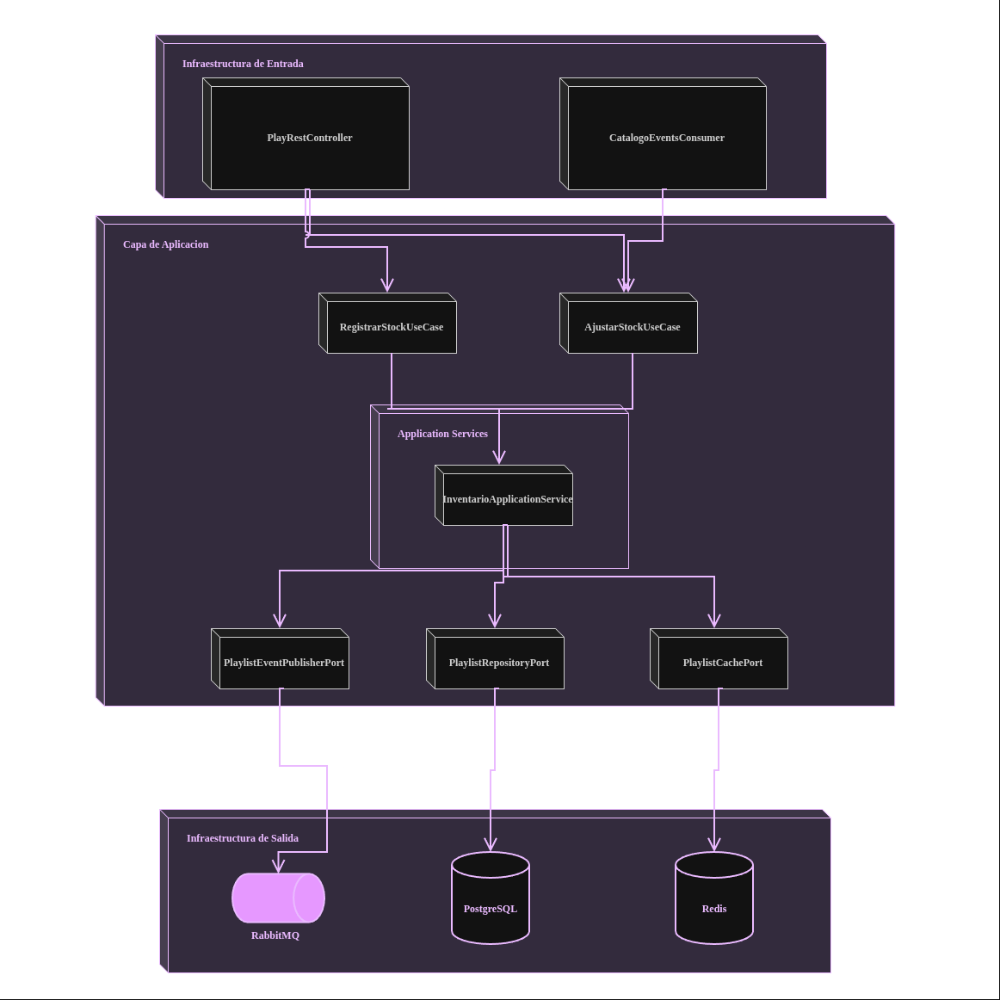
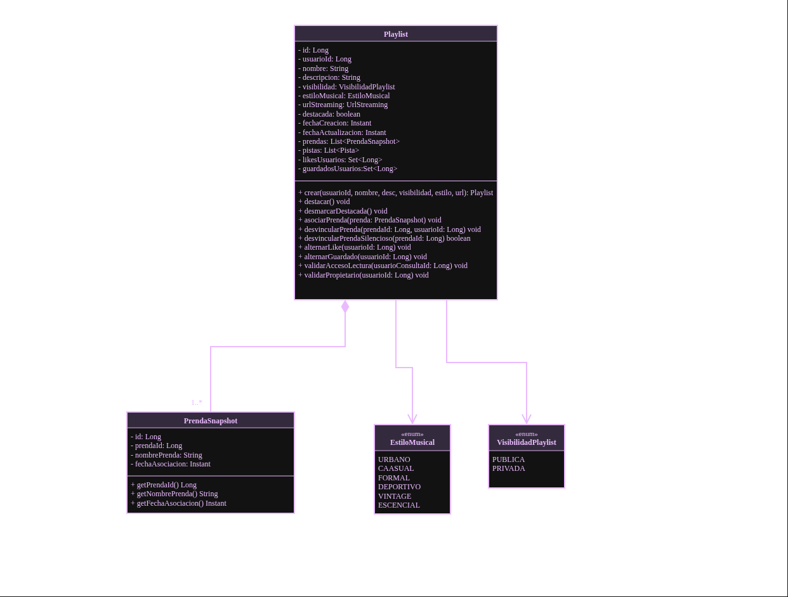
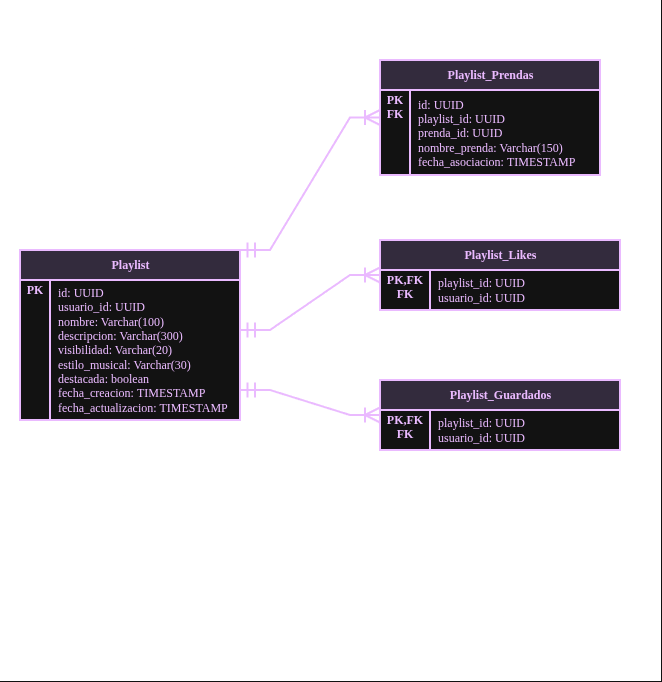

<div align="center">

  <a href="https://github.com/StyleRadar1">
    
  </a>

  <h1>STYLE<font color="#5600EF">RADAR</font> &nbsp;·&nbsp; <code>ms-playlist</code></h1>

  <p align="center">
    
    
    
  </p>

  <p align="center">
    <strong><font color="#5600EF">Descubre tu estilo. En tu ciudad.</font></strong><br />
    <em>Curaduría de estilo y cultura urbana vinculando prendas locales a colecciones temáticas y lookbooks de arquetipo.</em>
  </p>

  <p align="center">
    <a href="https://styleradar-backend-prod.azurewebsites.net/swagger-ui/index.html">
      
    </a>
    <a href="https://styleradar-backend-qa.azurewebsites.net/swagger-ui/index.html">
      
    </a>
    <a href="target/site/jacoco/index.html">
      
    </a>
    <a href="#6-tecnologías-y-dependencias">
      
    </a>
    <a href="#6-tecnologías-y-dependencias">
      
    </a>
    <a href="#7-cómo-ejecutar-local-y-con-docker">
      
    </a>
  </p>

</div>

---

##  ÍNDICE DE CONTENIDOS

1. [Nombre del servicio y su bounded context](#1-nombre-del-servicio-y-su-bounded-context)
2. [Equipo y responsables](#2-equipo-y-responsables)
3. [Arquitectura hexagonal con su diagrama](#3-arquitectura-hexagonal-con-su-diagrama)
4. [Endpoints y enlace a Swagger](#4-endpoints-y-enlace-a-swagger)
5. [Eventos que publica y consume](#5-eventos-que-publica-y-consume)
6. [Tecnologías y dependencias](#6-tecnologías-y-dependencias)
7. [Cómo ejecutar local y con Docker](#7-cómo-ejecutar-local-y-con-docker)
8. [Variables de entorno](#8-variables-de-entorno)
9. [Pruebas y cobertura](#9-pruebas-y-cobertura)
10. [CI/CD con el badge del pipeline](#10-cicd-con-el-badge-del-pipeline)
11. [Ramas y cómo contribuir](#11-ramas-y-cómo-contribuir)
12. [Enlace a la épica en Jira](#12-enlace-a-la-épica-en-jira)

---

<a id="1-nombre-del-servicio-y-su-bounded-context"></a>

##  1. NOMBRE DEL SERVICIO Y SU BOUNDED CONTEXT

* **Identificador de Servicio:** `ms-playlist` (`RST-Playlist-Service`)
* **Paquete Arquitectónico:** `Paquete 2: Catálogo y Experiencia de Usuario`
* **Puerto de Escucha Oficial:** `8260`
* **Base de Datos Asignada:** `PostgreSQL 16` (`playlist_db`), aislada bajo el patrón *Database-per-Service*.
* **Bounded Context:** `Playlists de Estilo y Curaduría de Moda (Lookbooks)`

### Responsabilidades del Dominio

Este microservicio encapsula exclusivamente la lógica de negocio correspondiente a la curaduría de estilo, colecciones temáticas de ropa (Lookbooks) y outfits asociados a arquetipos de moda (representado por Mateo - Calle).

| Qué HACE este Microservicio (Alcance) | Qué NO HACE este Microservicio (Límites) |
| :--- | :--- |
| • Creación, edición y publicación de playlists de estilo / lookbooks de prendas. | • NO reproduce ni almacena archivos de audio ni canciones mp3 (es 100% moda). |
| • Asociación de hasta 15 prendas de vestir activas por colección (`RNF-12`). | • NO gestiona stock ni existencias físicas de prendas (delegado a `ms-inventario` en `:8200`). |
| • Gestión del carrusel de hasta 3 playlists destacadas para el Home (`SR-RF-72`). | • NO procesa transacciones de pago ni suscripciones (delegado a `ms-pagos-suscripciones`). |
| • Almacenamiento en caché de alta velocidad (Redis L2) para las 3 destacadas. | • NO autentica usuarios (validación centralizada delegada al API Gateway / `ms-auth`). |

### Arquetipos de Moda y Personajes de StyleRadar

<div align="center">

| Antonia (Sastre) | Mateo (Calle) | Aura (Futuro) | Nora (Rebelde) | Tomás (Esencial) |
| :---: | :---: | :---: | :---: | :---: |
| <br>**Sastre**<br><sub>Tiendas & Descubrimiento</sub> | <br>**Calle**<br><sub>Lookbooks & Cultura Urbana</sub> | <br>**Futuro**<br><sub>Probador Virtual AI</sub> | <br>**Rebelde**<br><sub>Segunda Vida & Vintage</sub> | <br>**Esencial**<br><sub>Fundaciones & Donaciones</sub> |

</div>

---

<a id="2-equipo-y-responsables"></a>

##  2. EQUIPO Y RESPONSABLES

Desarrollado y mantenido por el **Squad Estación RESTrepo** para la asignatura DOSW 2026.

<div align="center">

| Rol | Nombre Completo | Usuario GitHub |
| :---: | :---: | :---: |
| **Product Owner / Líder** | Nicolás Álvarez | `[@JUANNICOLASA](https://github.com/JUANNICOLASA)` |
| **Tech Lead / Arquitecto** | Daniel Mosquera | `[@DanielMosquera](https://github.com)` |
| **Backend Developer** | Sebastián Camilo Granados | `[@sebas-granados](https://github.com)` |

</div>

---

<a id="3-arquitectura-hexagonal-con-su-diagrama"></a>

##  3. ARQUITECTURA HEXAGONAL CON SU DIAGRAMA

El microservicio implementa **Arquitectura Hexagonal (Puertos y Adaptadores)** combinada con **Domain-Driven Design (DDD)**. El núcleo de negocio permanece 100% puro en Java 21 y aislado de frameworks, bases de datos o brokers de mensajería.


---

### Evidencias de Arquitectura y Diseño (RES-81)

#### 1. Diagrama de Componentes (Arquitectura Hexagonal)


#### 2. Diagrama de Clases (Dominio Puro DDD)


#### 3. Diagrama Entidad-Relación (Base de Datos Relacional)


---

### Estructura Oficial de Paquetes en `src/main/java/`

```text
src/main/java/edu/dosw/styleradar/playlist/
├── domain/                                  <-- NÚCLEO DE DOMINIO (Cero dependencias externas)
│   ├── model/                               <-- Agregado Playlist, entidad PrendaSnapshot
│   ├── valueobject/                         <-- Estilo, VisibilidadPlaylist
│   ├── event/                               <-- Eventos de Dominio (PlaylistDestacadaEvent, PrendaVinculadaEvent)
│   └── exception/                           <-- Excepciones de negocio (LimiteDestacadasSuperadoException, etc.)
├── application/                             <-- CAPA DE APLICACIÓN (Casos de Uso)
│   ├── port/
│   │   ├── in/                              <-- Input Ports (Interfaces para casos de uso)
│   │   └── out/                             <-- Output Ports (Interfaces para persistencia, caché y mensajería)
│   ├── usecase/                             <-- Implementación de servicios de aplicación
│   └── dto/                                 <-- DTOs de entrada y salida (Java Records)
└── infrastructure/                          <-- CAPA DE INFRAESTRUCTURA (Adaptadores)
    ├── adapter/
    │   ├── in/
    │   │   ├── rest/                        <-- Spring REST Controllers y OpenAPI Spec
    │   │   └── amqp/                        <-- Consumidor RabbitMQ catalogo.prenda.eliminada
    │   └── out/
    │       ├── persistence/                 <-- Spring Data JPA Repositories y Entidades SQL
    │       ├── messaging/                   <-- Productor RabbitMQ (AmqpTemplate)
    │       └── cache/                       <-- Adaptador Redis (RedisTemplate L2)
    └── config/                              <-- Configuración Spring (Security, Cache, OpenApi)
```

---

<a id="4-endpoints-y-enlace-a-swagger"></a>

##  4. ENDPOINTS Y ENLACE A SWAGGER

### Matriz Oficial de Enlaces por Entorno (PROD, QA, LOCAL)

| Entorno | Estado | Propósito | URL Base del Servicio | Swagger OpenAPI UI | Health Check |
| :--- | :---: | :--- | :--- | :--- | :--- |
| **Producción (PROD)** | Active | Despliegue productivo de StyleRadar | `https://styleradar-backend-prod.azurewebsites.net` | [Swagger UI PROD](https://styleradar-backend-prod.azurewebsites.net/swagger-ui/index.html) | [`/actuator/health`](https://styleradar-backend-prod.azurewebsites.net/actuator/health) |
| **Calidad / Pruebas (QA)** | Active | Pruebas integradas de Sprint y QA | `https://styleradar-backend-qa.azurewebsites.net` | [Swagger UI QA](https://styleradar-backend-qa.azurewebsites.net/swagger-ui/index.html) | [`/actuator/health`](https://styleradar-backend-qa.azurewebsites.net/actuator/health) |
| **Desarrollo Local (DEV)** | Local | Entorno de desarrollo local en máquina | `http://localhost:8260` | [Swagger UI Local](http://localhost:8260/swagger-ui.html) | [`/actuator/health`](http://localhost:8260/actuator/health) |

* **Especificación OpenAPI (Contrato JSON Schema):** `http://localhost:8260/v3/api-docs`

### Tabla de Endpoints Expuestos

| Método | Endpoint | Descripción | Rol Requerido | Códigos HTTP |
| :---: | :--- | :--- | :--- | :---: |
| `GET` | `/api/v1/playlists/health` | Health Check y estado del microservicio | Público | `200` |
| `GET` | `/api/v1/playlists/destacadas` | Lista hasta 3 playlists destacadas para el Home (Redis L2) | Público | `200` |
| `GET` | `/api/v1/playlists/populares` | Playlists públicas paginadas ordenadas por ranking de likes | Público | `200` |
| `GET` | `/api/v1/playlists/{id}` | Detalle de lookbook con prendas asociadas | Público / Autenticado | `200`, `404` |
| `POST` | `/api/v1/playlists` | Crear nuevo lookbook vinculado a un estilo | `COMPRADOR`, `ADMIN` | `201`, `400` |
| `PUT` | `/api/v1/playlists/{id}/destacar` | Fija una playlist como destacada (máx 3 · SR-RF-72) | `ADMIN` | `200`, `409` |
| `POST` | `/api/v1/playlists/{id}/prendas` | Asociar una prenda de vestir al lookbook (máx 15 · RNF-12) | Dueño de playlist | `200`, `404`, `422` |
| `POST` | `/api/v1/playlists/{id}/like` | Alternar Me Gusta en la playlist | `COMPRADOR` | `200`, `404` |

<details>
<summary><b>Click para ver Ejemplos Interactivos de Request y Response JSON (Payloads)</b></summary>

<br>

#### Ejemplo Request (`POST /api/v1/playlists`)

```bash
curl -X POST "http://localhost:8260/api/v1/playlists" \
  -H "Content-Type: application/json" \
  -H "Authorization: Bearer <JWT_TOKEN>" \
  -d '{
    "nombre": "Vibra Urbana Bogotá",
    "descripcion": "Selección de prendas streetwear y hoodies oversize locales",
    "estilo": "URBANO",
    "visibilidad": "PUBLICA"
  }'
```

#### Ejemplo Response Exitoso (`201 Created`)

```json
{
  "id": 105,
  "usuarioId": 42,
  "nombre": "Vibra Urbana Bogotá",
  "descripcion": "Selección de prendas streetwear y hoodies oversize locales",
  "estilo": "URBANO",
  "visibilidad": "PUBLICA",
  "destacada": false,
  "totalPrendas": 0,
  "likes": 0,
  "fechaCreacion": "2026-11-04T15:00:00Z"
}
```

</details>

---

<a id="5-eventos-que-publica-y-consume"></a>

##  5. EVENTOS QUE PUBLICA Y CONSUME

La comunicación asíncrona entre microservicios se orquesta a través de **RabbitMQ 3.12** utilizando Topic Exchanges durables.

* **Exchange Principal de Dominio:** `styleradar.events` (`topic`, durable)
* **Dead Letter Exchange (DLX):** `styleradar.dlx`

### Matriz de Eventos AMQP

| Tipo | Routing Key | Cola (Queue) | Microservicio Emisor / Receptor | Cuándo se Dispara / Acción |
| :---: | :--- | :--- | :--- | :--- |
| **PUBLICA** | `playlist.destacada.actualizada` | N/A (Exchange) | `ms-playlist` | Invalida la caché Redis del carrusel principal en la app móvil y web. |
| **PUBLICA** | `playlist.prenda.asociada` | N/A (Exchange) | `ms-playlist` | Notifica eventos de curaduría para métricas en `ms-estadisticas`. |
| **CONSUME** | `catalogo.prenda.eliminada` | `q.playlist.prenda-eliminada` | `ms-item-catalogo` &rarr; `ms-playlist` | Desvincula automáticamente prendas retiradas del catálogo de las listas activas. |

---

<a id="6-tecnologías-y-dependencias"></a>

##  6. TECNOLOGÍAS Y DEPENDENCIAS

| Capa / Componente | Tecnología | Versión | Justificación Técnica |
| :--- | :--- | :--- | :--- |
| **Lenguaje Core** | Java LTS | `21` | Inmutabilidad de Value Objects y Records para colecciones seguras de prendas. |
| **Framework Empresarial** | Spring Boot | `3.3.x` | Gestión declarativa de configuración, Spring Data JPA y endpoints REST. |
| **Base de Datos** | PostgreSQL | `16` | Persistencia relacional de playlists y tablas asociativas desacopladas. |
| **Migraciones de BD** | Flyway | `10.x` | Control de versiones reproducible de scripts SQL (`V1__init.sql`) en arranque. |
| **Broker de Mensajería** | RabbitMQ | `3.12+` | Desacoplamiento temporal de eventos de catálogo hacia las listas de curaduría. |
| **Caché en Memoria** | Redis | `7.x` | Almacenamiento L2 de las 3 playlists destacadas del Home para latencia < 5ms. |
| **Mapeo de DTOs** | MapStruct | `1.5.x` | Mapeo compilado libre de reflection entre agregados y DTOs de salida. |
| **Testing Core** | JUnit 5 + Mockito | `5.10.x` | Pruebas unitarias sobre las reglas de negocio del agregado de playlists. |
| **Testing Integración** | Testcontainers | `1.19.x` | Instanciación automática de PostgreSQL y RabbitMQ durante `mvn verify`. |
| **Métricas de Cobertura** | JaCoCo Plugin | `0.8.12` | Verificación estricta de cobertura mínima (≥ 85%) como regla de fallo en el build. |

---

<a id="7-cómo-ejecutar-local-y-con-docker"></a>

##  7. CÓMO EJECUTAR LOCAL Y CON DOCKER

### Prerrequisitos de Entorno

* **Java Development Kit (JDK):** Versión 21 LTS instalada (`java -version`).
* **Apache Maven:** Versión 3.9+ instalada (`mvn -version`).
* **Docker Engine & Docker Compose:** Versión 24+ en ejecución (`docker --version`).

### Despliegue de Infraestructura Local (`docker-compose.yml`)

El microservicio incluye un archivo de infraestructura para levantar PostgreSQL, Redis y RabbitMQ localmente:

```yaml
version: '3.8'

services:
  postgres:
    image: postgres:16-alpine
    container_name: styleradar-postgres-playlist
    restart: always
    environment:
      POSTGRES_DB: playlist_db
      POSTGRES_USER: styleradar_user
      POSTGRES_PASSWORD: secret_dev_pass
    ports:
      - "5432:5432"
    volumes:
      - pgdata_playlist:/var/lib/postgresql/data

  redis:
    image: redis:7-alpine
    container_name: styleradar-redis-playlist
    restart: always
    ports:
      - "6379:6379"

  rabbitmq:
    image: rabbitmq:3.12-management-alpine
    container_name: styleradar-rabbitmq-playlist
    restart: always
    ports:
      - "5672:5672"
      - "15672:15672"
    environment:
      RABBITMQ_DEFAULT_USER: guest
      RABBITMQ_DEFAULT_PASS: guest

volumes:
  pgdata_playlist:
```

### Ejecución Local con Maven (Perfil Dev)

```bash
# 1. Clonar el repositorio
git clone https://github.com/StyleRadar1/ms-playlist.git
cd ms-playlist

# 2. Levantar la infraestructura local en Docker
docker compose up -d

# 3. Compilar y ejecutar el microservicio en puerto 8260
mvn clean spring-boot:run -Dspring-boot.run.profiles=dev
```

### Comprobación de Salud (Health Check)

```bash
curl -s http://localhost:8260/actuator/health | jq .
# Esperado: {"status":"UP","components":{"db":{"status":"UP"},"redis":{"status":"UP"}}}
```

---

<a id="8-variables-de-entorno"></a>

##  8. VARIABLES DE ENTORNO

Todas las configuraciones se externalizan conforme al estándar **Twelve-Factor App**. En producción, la base de datos oficial se encuentra aprovisionada en Azure Database for PostgreSQL.

### Matriz de Parámetros de Configuración

| Variable | Descripción | Valor Local (`dev`) | Valor Producción (`prod`) |
| :--- | :--- | :--- | :--- |
| `SERVER_PORT` | Puerto HTTP del servicio | `8260` | `8260` |
| `SPRING_PROFILES_ACTIVE`| Perfil activo de Spring | `dev` | `prod` |
| `DB_HOST` | Host del servidor PostgreSQL | `localhost` | `styleradar-postgres-prod.postgres.database.azure.com` |
| `DB_PORT` | Puerto de conexión a PostgreSQL| `5432` | `5432` |
| `DB_NAME` | Nombre de la base de datos | `playlist_db` | `playlist_db` |
| `DB_USER` | Usuario de conexión BD | `styleradar_user` | `styleradar_admin@styleradar-postgres-prod` |
| `DB_PASSWORD` | Contraseña de conexión BD | `secret_dev_pass` | `${SECRET_AZURE_DB_PASSWORD}` |
| `REDIS_HOST` | Hostname del servidor Redis | `localhost` | `styleradar-redis-prod.redis.cache.windows.net` |
| `REDIS_PORT` | Puerto de conexión Redis | `6379` | `6380` |
| `RABBITMQ_HOST` | Hostname broker RabbitMQ | `localhost` | `styleradar-rabbitmq.eastus.cloudapp.azure.com` |
| `MAX_PLAYLISTS_DESTACADAS`| Límite estricto carrusel Home | `3` | `3` |

### Archivo de Ejemplo `.env.example`

```properties
# ==============================================================================
# CONFIGURACIÓN DE ENTORNO - STYLE RADAR: MS-PLAYLIST (:8260)
# ==============================================================================

SERVER_PORT=8260
SPRING_PROFILES_ACTIVE=dev

# Conexión PostgreSQL (En Prod: styleradar-postgres-prod.postgres.database.azure.com)
DB_HOST=localhost
DB_PORT=5432
DB_NAME=playlist_db
DB_USER=styleradar_user
DB_PASSWORD=secret_dev_pass

# Conexión Redis L2 Cache
REDIS_HOST=localhost
REDIS_PORT=6379
REDIS_PASSWORD=

# RabbitMQ Event Broker
RABBITMQ_HOST=localhost
RABBITMQ_PORT=5672
RABBITMQ_USER=guest
RABBITMQ_PASS=guest

# Reglas de Dominio StyleRadar
MAX_PLAYLISTS_DESTACADAS=3
```

---

<a id="9-pruebas-y-cobertura"></a>

##  9. PRUEBAS Y COBERTURA (≥ 85%)

El proyecto exige una cobertura de código mínima del **85%** verificada automáticamente mediante el plugin de **JaCoCo** durante la fase de compilación.

```bash
# Ejecutar pruebas unitarias y de integración
mvn clean verify

# Generar reporte HTML de cobertura
mvn jacoco:report
```

* **Ruta del Reporte HTML:** `target/site/jacoco/index.html`

> [!IMPORTANT]
> **Criterio de Fallo en CI:** El archivo `pom.xml` contiene la regla `<limit><minimum>0.85</minimum></limit>`. Si la cobertura total consolidada es inferior al 85%, el comando `mvn verify` fallará con error y el pipeline bloqueará el Pull Request.

---

<a id="10-cicd-con-el-badge-del-pipeline"></a>

##  10. CI/CD CON EL BADGE DEL PIPELINE

* **Pipeline QA:** [](https://github.com/StyleRadar1/ms-playlist/actions)
* **Pipeline PROD:** [](https://github.com/StyleRadar1/ms-playlist/actions)

---

<a id="11-ramas-y-cómo-contribuir"></a>

##  11. RAMAS Y CÓMO CONTRIBUIR

El equipo sigue el modelo **GitFlow adaptado para microservicios**.

### Formato de Ramas Oficial

```text
main                    <-- Producción
└── develop             <-- Integración continua (Staging / QA)
    ├── feature/SR-<ID>-<descripcion-corta>   <-- Nuevas funcionalidades
    └── bugfix/SR-<ID>-<descripcion-corta>    <-- Corrección de defectos
```

### Convención de Commits (*Conventional Commits*)

```text
feat(playlist): implementar logica de destacar maximo 3 playlists [#SR-RF-72]
feat(playlist): endpoint para asociar prendas de vestir a lookbook [#SR-RF-70]
test(playlist): pruebas unitarias para agregado de playlist y arquetipos [#SR-RF-69]
fix(playlist): desvincular referencias de prendas eliminadas con amqp [#SR-RF-70]
```

---

<a id="12-enlace-a-la-épica-en-jira"></a>

##  12. ENLACE A LA ÉPICA EN JIRA

* **Épica y Tablero Oficial de Trabajo:** [https://mail-team-nyjtgqcj.atlassian.net/jira/software/projects/RES/boards/76/timeline?selectedIssue=RES-4](https://mail-team-nyjtgqcj.atlassian.net/jira/software/projects/RES/boards/76/timeline?selectedIssue=RES-4)

### Requerimientos Funcionales Asignados

| Código RF | Nombre del Requerimiento | Actor Principal | Criterio de Aceptación Clave |
| :---: | :--- | :--- | :--- |
| `SR-RF-69` | Crear lookbook vinculado a estilo de moda | Curador / Admin / Comprador | Persiste playlist asignándole arquetipo cultural urbano (Mateo - Calle). |
| `SR-RF-70` | Asociar prendas de vestir al lookbook | Tienda / Comprador | Vincula prendas existentes con límite máximo de 15 por lista (`RNF-12`). |
| `SR-RF-71` | Consultar playlists, dar likes y guardar en perfil | Comprador | Permite interacción social y filtrado según visibilidad pública o privada. |
| `SR-RF-72` | Destacar hasta 3 playlists en el inicio | Admin / Sistema | Valida que nunca existan más de 3 playlists activas en el carrusel de Home. |
